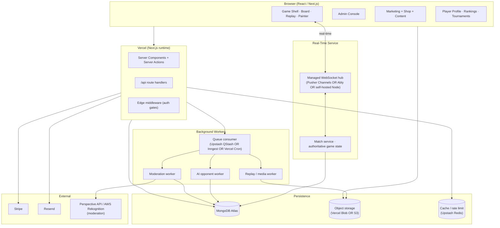
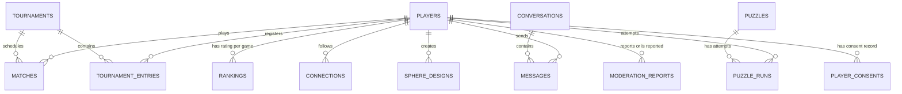

# Sphere of Kings — Digital Gaming Platform Implementation Roadmap

> Status: planning deliverable. Not an instruction to implement.
> Author: architecture + planning pass against the live `main` branch.
> Last codebase snapshot inspected: commit `3752221` (Oct 2026).

This document plans the evolution of `sphereofkings.com` from the current **commerce + brand** site into a full **digital gaming platform** — browser gameplay, AI opponents, puzzles, player accounts, real-time multiplayer, tournaments, and community. It is grounded in what the repository actually contains today; everything else is marked as recommendation, assumption, or open question.

---

## 1. Executive Summary

The current site is a Next.js 15 (App Router) commerce + admin monolith backed by MongoDB Atlas, Stripe (test mode), and Resend. It is deployed on Vercel at `https://www.sphereofkings.com`. Everything on it is **commerce- and marketing-oriented** — the shop, cart, checkout, the Our Story / How to Play / Wholesale / Donate / Affiliate pages, the signup flow, and an admin console with Orders, Fulfillment, Products, Affiliates, Wholesale, Finance, Subscribers, Emails and Audit surfaces.

**There is no digital gameplay in the repository today.** No board rendering, no game-rule engine, no move validation, no AI, no WebSocket layer, no player-account system beyond the admin + affiliate records, no tournament schema, no messaging, no replays, no 3D rendering libraries, no image-processing pipeline.

The requested platform is therefore an additive build on top of a healthy commerce base, not a refactor. The recommended path:

1. **Phase 0** — resolve blocking product decisions (game rules, child-safety policy, paid-tournament jurisdiction, hosting-cost ceiling) before writing engine code.
2. **Phase 1 MVP** — ship **browser Royal Checkers vs AI (single-player, 3 difficulty tiers)** plus **player accounts with public profiles**. This is the smallest coherent slice that proves the platform is a gaming destination and generates behavioural data to tune everything else.
3. **Phases 2 → 9** — layer puzzles, rankings, real-time multiplayer, tournaments, messaging, replays, customization, community.

Do **not** try to ship all requested features at once. Multiplayer, tournaments, messaging, parental consent, and paid competition each carry non-trivial legal, security, and operational cost; staging them avoids blocking the MVP on the slowest surface.

The MVP (Phases 0 + 1 + the account layer from Phase 3) is estimated at **~8–14 engineering weeks** at one senior-level contributor's pace, assuming product decisions do not slip. The complete platform is a **9–15 month** program at the same pace.

---

## 2. Current Codebase Assessment

**Repository shape** (from inspection):

```
/
├── nextjs/                        # The whole app
│   ├── app/                       # App Router routes
│   │   ├── admin/*                # 10 admin surfaces
│   │   ├── affiliate/*            # Public dashboard + signup + signin
│   │   ├── api/                   # Stripe webhook + subscribers count
│   │   ├── cart, checkout, shop/* # Commerce
│   │   ├── donate, our-story, how-to-play, videos, wholesale, wholesale-checkout
│   │   ├── r/[code]/              # Affiliate referral entry point
│   │   ├── subscribe/             # Double opt-in confirm / unsubscribe
│   │   ├── order/[ref]/           # Public order confirmation
│   │   ├── layout.tsx, page.tsx, providers.tsx, fonts.css
│   ├── components/                # ~60 React components (styled-components)
│   ├── lib/
│   │   ├── auth/                  # scrypt hash, HMAC session tokens, actor
│   │   ├── db/
│   │   │   ├── mongo.ts           # Mongo client singleton + hasMongo()
│   │   │   └── collections/*      # 7 collections modules
│   │   ├── email/send.ts          # Resend REST wrapper
│   │   ├── finance/reconcile.ts
│   │   ├── store/                 # file-fallback + Mongo stores for quotes, finance, subscribers
│   │   ├── stripe/                # server client + mock-vs-real adapter
│   │   ├── affiliate-*.ts         # auth cookie, promotion, tiers
│   │   ├── products.ts            # 13-SKU hard-coded catalog
│   │   ├── sample-*.ts            # demo data (seeders now no-op in prod)
│   │   └── wholesale-*.ts
│   ├── middleware.ts              # Edge gate on /admin
│   ├── public/images/             # Hero + product images
│   ├── scripts/                   # add-admin, reseed-products, drop-demo-data
│   ├── next.config.ts             # styled-components SWC + TS/ESLint ignored in build
│   └── package.json
├── README.md                      # (sparse)
└── SPHERE_OF_KINGS_DIGITAL_PLATFORM_IMPLEMENTATION_ROADMAP.md   # this file
```

**Observed strengths**
- Clean server-action pattern throughout; `use server` boundaries are consistent.
- Mongo-first with file fallback across stores — mature pattern.
- Scrypt + HMAC-signed stateless session cookies ([lib/auth](nextjs/lib/auth)); edge middleware re-verifies.
- Audit log is pervasive, append-only, and already shows actor+action+details across the console.
- Stripe adapter supports mock mode so the UI never lies about "paid" before the webhook confirms.

**Observed gaps relative to the new platform brief**
- No general-purpose end-user account model (only admins + affiliates).
- No real-time infrastructure (Vercel is serverless; WebSockets require a different host or a provider like Pusher/Ably).
- No 3D or canvas rendering code; the sphere imagery is static JPEG.
- No image-processing pipeline, no object storage (uploads currently nonexistent).
- No queue / background worker.
- All UI uses styled-components v6; TypeScript errors are configured to NOT block the Vercel build (loose CI).

---

## 3. Existing Architecture and Technology Stack

| Layer | Technology | Notes |
|---|---|---|
| Frontend framework | Next.js 15 (App Router), React 19 | SSR + server actions + Edge middleware |
| Styling | styled-components 6.1.13 (SSR via `StyledRegistry`) | No Tailwind, no CSS modules |
| Language | TypeScript 5.6 | Build-time type checking disabled in [next.config.ts](nextjs/next.config.ts) — ships-first posture |
| Payments | Stripe (SDK 17 + stripe-js 10 + react-stripe-js 7) | Payment Element; webhook at `/api/stripe/webhook` |
| Database | MongoDB Atlas (driver `mongodb@6.21`) | 7 live collections; file fallback for dev |
| Email | Resend (REST, no SDK; wrapped in [lib/email/send.ts](nextjs/lib/email/send.ts)) | server-only; dynamic import of react-dom/server |
| QR codes | `qrcode@1.5` | Used in affiliate poster |
| Session tokens | Web Crypto HMAC (Edge-safe) | 32-byte secret; separate kinds for admin + affiliate |
| Password hashing | Node `scrypt` ([lib/auth/password.ts](nextjs/lib/auth/password.ts)) | 16384/8/1 with 64MiB maxmem |
| Hosting | Vercel (serverless + Edge middleware) | No persistent process; no WebSocket server |
| Analytics / observability | None configured | Only `console.error` on webhook failure |

---

## 4. Existing Functionality — Implemented / Partial / Mocked / Missing

### Fully implemented
- **Catalog & shop** — 13 SKUs with real prices in [lib/products.ts](nextjs/lib/products.ts) + Mongo-backed persistence in [lib/db/collections/products.ts](nextjs/lib/db/collections/products.ts).
- **Cart + checkout + Stripe** — client-side cart ([lib/cart.tsx](nextjs/lib/cart.tsx)), full checkout stepper ([components/checkout/CheckoutStepper.tsx](nextjs/components/checkout/CheckoutStepper.tsx)), server-computed totals, Payment Element, webhook flips the order and sends confirmation email.
- **Admin console** — 10 surfaces: Overview, Orders, Order Detail, Fulfillment (with persistence + dispatch email), Products, Affiliates (with payouts + statement email), Wholesale (with approval email + token), Finance (live Stripe + attribution totals), Subscribers (with broadcast behind a confirm-by-count guard), Emails (preview + send-test), Audit.
- **Session-based admin auth** — [app/admin/signin/actions.ts](nextjs/app/admin/signin/actions.ts); scrypt verified; HMAC cookie.
- **Affiliate program** — self-signup at `/affiliate/apply`, Mongo-backed account record, `/r/[code]` entry point with first-touch / last-touch / linear / u-shape / split attribution models, self-referral guard, window enforcement, tier auto-promotion, payouts with statement email, admin UI, dashboard.
- **Wholesale** — public inquiry form, admin queue, single-use approval token, cookie handoff into checkout, discount application, stock reservation, auto decision email.
- **Subscriber signup** — double opt-in via `/subscribe/confirm/[token]`, abacus-backed live counter, Formspree inbox mirror, broadcast action.
- **Audit log** — append-only Mongo collection; written from every server action; UI at `/admin/audit`.
- **Content pages** — Our Story, How to Play (Royal Checkers + Imperial Kings approved rules; others draft), Videos, Donate, Wholesale, Affiliate landing.

### Partial
- **How to Play rules** — Royal Checkers has sections 01, 02, 03 (new "stacked king returns home"), 04 (new "Kings Face Off"); seam adjacency still draft. Imperial Kings has winning + board rules; setup / movement / draws still draft. The five other modes are description-only.
- **Finance CSV/PDF export** — buttons present; the Stripe sync, reconciliation, and month-close actions wired.
- **Email templates** — Launch Announcement, Order Confirmation, Dispatch Notice, Wholesale Decision, Affiliate Payout Statement; render-to-static-markup pipeline works; sending gated on `RESEND_API_KEY`.

### Mocked
- **Stripe adapter** — [lib/stripe/adapter.ts](nextjs/lib/stripe/adapter.ts) returns `SAMPLE_STRIPE_TX` when `STRIPE_SECRET_KEY` is unset.
- **Carrier / tracking inputs** in Fulfillment — rendered but not persisted; labelled honestly in the UI.

### Missing (relevant to this brief)
- Any browser game logic (rules, boards, pieces, move validation).
- Any AI engine (minimax, MCTS, trained model, external AI API).
- Any end-user (non-admin, non-affiliate) account system or profile page.
- Any ranking / leaderboard infrastructure.
- Any tournament schema or bracket code.
- Any WebSocket, Server-Sent-Events, Pusher, Ably, or long-poll handler.
- Any messaging / notifications infrastructure (email aside).
- Any image upload / processing / moderation.
- Any 3D rendering (no three.js, no react-three-fiber, no canvas game loop).
- Any replay recording / video rendering.
- Any sphere painting / customization editor.
- Any blog / vlog / CMS integration.
- Any child-safety / parental-consent workflow.
- Any location-aware regional ranking logic.

---

## 5. Product Vision and Proposed Platform Architecture

### Vision
Sphere of Kings becomes a destination where a visitor can **play the games they would otherwise only own**, climb a competitive ladder, enter tournaments, and co-create content — all while continuing to purchase physical boards from the existing shop.

### Guiding principles
- **Extend, don't replace.** The commerce + admin platform stays as the business backbone. Game surfaces live alongside it.
- **Deterministic rules first, pretty rendering second.** The game engine's correctness is the foundation of every downstream feature (ranking, replay, tournament). Rules must be nailed down before the sphere becomes animated.
- **Server-authoritative game state for anything competitive.** Rankings and tournaments require a server that is the single source of truth; the browser is a renderer, never a validator.
- **Pay for infrastructure once.** Multiplayer, puzzles, tournaments, and replays all benefit from the same real-time + queue + object-storage stack. Introduce it in one deliberate phase.
- **Safety is architecture, not a last-mile patch.** Parental consent and moderation must land before public messaging and public uploads.

### Proposed architecture (target state)



### Key architectural decisions still to make
1. **Managed WebSocket vendor vs. self-hosted Node service.** Vercel does not host long-lived connections — see Section 10.
2. **AI runtime location.** Browser (WebAssembly) vs. server worker — see Section 8.
3. **3D vs. 2D board rendering.** react-three-fiber vs. a 2D canvas with isometric or orthographic projection — see Section 7.
4. **Object storage provider.** Vercel Blob is cheapest to adopt; S3 scales further.

---

## 6. Complete Feature Inventory and Feasibility Assessment

Every requested feature with current state, risk, and complexity. **Complexity scale**: L / M / H / VH.

| # | Feature | Current state | Complexity | Primary risk |
|---|---|---|---|---|
| F1 | Browser Royal Checkers | Missing | H | Unresolved spherical seam rules |
| F2 | Browser Imperial Kings | Missing | H | Unresolved setup + movement rules |
| F3 | Spherical board rendering | Missing | H | Rendering tech choice; mobile perf |
| F4 | Legal move / win validation | Missing | M | Needs rule-source-of-truth |
| F5 | AI 1–100 difficulty | Missing | H | Not 100 models — one engine, tuned |
| F6 | Easy / medium / hard puzzles | Missing | M | Need generator spec |
| F7 | Custom-image puzzle | Missing | H | Uploads + moderation + puzzlize pipeline |
| F8 | Kid-friendly puzzles | Missing | M | Depends on parental consent (F15) |
| F9 | Player registration / login | Missing (admin + affiliate only) | M | Can reuse auth lib |
| F10 | Player profiles + privacy | Missing | M | Visibility rules + age gate |
| F11 | Player search | Missing | L | Index on username |
| F12 | Rankings / Elo / Glicko | Missing | M | Policy decisions |
| F13 | Regional (state / nat'l / global) leaderboards | Missing | H | Location verification is non-trivial |
| F14 | Real-time direct challenges | Missing | VH | New real-time service |
| F15 | Parental consent | Missing | H | COPPA/GDPR-K; jurisdictional |
| F16 | State tournaments | Missing | H | Depends on F12 + F14 |
| F17 | National tournaments | Missing | H | Same |
| F18 | Worldwide tournaments | Missing | H | Same + timezone / scheduling |
| F19 | Paid entry + prizes | Missing | VH | Legal, tax, gambling classification |
| F20 | Champions page | Missing | L | Simple view on tournament data |
| F21 | Private messaging | Missing | H | Moderation + child-safety |
| F22 | Tournament / challenge invites | Missing | M | Depends on F14 |
| F23 | Match / profile / puzzle sharing links | Missing | L | Open-graph + public read endpoints |
| F24 | Notifications | Missing (email-only) | M | In-app + push + email fanout |
| F25 | External social sharing | Missing | L | Share intents, not posting |
| F26 | Move-history replay | Missing | M | Depends on game engine PGN-equivalent |
| F27 | Full video rendering of replays | Missing | VH | Server-side rendering cost; defer |
| F28 | Voice-over narration | Missing | M | Needs media capture + storage |
| F29 | Sphere painting / customization | Missing | H | Rendering + save model + physical handoff |
| F30 | Order a physical painted sphere | Missing | M | Reuses existing commerce; design handoff is manual |
| F31 | Blog | Missing | L | Markdown or Mongo-backed |
| F32 | Vlog / video content | Missing | M | Just use YouTube/Vimeo embeds first |
| F33 | Facebook-like community feed | Missing | VH | Defer; moderation-heavy |
| F34 | Reactions / comments | Missing | M | Only on official content first |

Note: 34 features. **Attempting all in one release is not realistic.** The MVP in Section 19 picks the smallest set that proves the gaming thesis.

---

## 7. Digital Game Engine and Game-Rule Requirements

### Rule source of truth
The repository's authoritative rules today are in [components/howtoplay/HowToPlay.tsx](nextjs/components/howtoplay/HowToPlay.tsx). As of this snapshot:
- **Royal Checkers approved**: 14 × 8 spherical board; standard checkers rules; "Stacked king returns home" variation; "Kings Face Off" game-type variation.
- **Royal Checkers draft**: seam adjacency; whether multi-jumps may cross the seam.
- **Imperial Kings approved**: both kings must be captured; 14 × 8 spherical board; wraps along the long dimension.
- **Imperial Kings draft**: starting positions, piece movement across the seam, promotion, repetition, stalemate.

### Must be resolved before engine coding (owner decisions)
| Decision | Blocks |
|---|---|
| Seam adjacency map (which squares connect across the wrap) | All of F1, F2 |
| Whether multi-jumps may traverse the seam mid-combo | F1 move validation |
| Imperial Kings starting positions on 14×8 | F2 |
| Imperial Kings piece movement when it crosses the seam (e.g. rook wrapping) | F2 |
| Promotion rules on a wrapping board (what counts as "last rank") | F2 |
| Draw / repetition / stalemate rules for Imperial Kings | F2 |
| Rules for the other 5 modes (Spherical Puzzle, DIY, Custom Upload, Expanded Challenges, Creator's Edition) | Everything beyond MVP |

### Engine architecture
Build **one engine module per game**, each exporting a pure functional API:

```
// shape only — illustrative
module royalCheckers {
  initial(): GameState
  legalMoves(state): Move[]
  apply(state, move): GameState
  outcome(state): "ongoing" | "red-wins" | "black-wins" | "draw"
  encode(state): string   // compact serialization for replay + sync
  decode(string): GameState
}
```

Rules live purely in the engine module. Rendering, animation, AI, and multiplayer sync all import that module.

### Rendering recommendation
The sphere **does not need true 3D** for MVP. Two viable approaches:

- **A — 2D projection (recommended for MVP).** Render the 14×8 board as a two-column strip with a visible "seam" indicator. Pieces move left-to-right; crossing the right edge re-enters on the left. Cheap to build, trivial to make responsive, zero WebGL overhead. The spherical character is communicated via the seam indicator plus the shop imagery.
- **B — True 3D with react-three-fiber + three.js.** Beautiful but adds ~300KB to bundle, requires a WebGL fallback, non-trivial on low-end Android. Keep it as a Phase 7 upgrade.

### Testing
Deterministic unit tests on legalMoves + apply + outcome, including the seam cases, kinging, splitting (Royal variation), Kings Face Off initial state. 100% branch coverage is realistic for a rules module and worth it — a bug here corrupts rankings, tournaments, and replays simultaneously.

---

## 8. AI Difficulty and Puzzle Architecture

### AI design
**Not 100 separately engineered AIs.** One minimax search with alpha-beta pruning + iterative deepening, with difficulty expressed as a function of:
- Search depth (plies).
- Evaluation function noise (deliberate blunder probability at low tiers).
- Opening-book randomness.
- Thinking-time budget.

```
difficulty 1    → depth 1, 60% random, 100ms budget
difficulty 25   → depth 3, 20% random, 500ms budget
difficulty 50   → depth 5, 5% random, 1500ms budget
difficulty 75   → depth 6, 1% random, 3000ms budget
difficulty 100  → depth 7+, iterative deepening until budget exhausted
```

Expose it as **three preset tiers (Easy / Medium / Hard) at MVP**, mapped to difficulty 20 / 50 / 80. Only expose the full 1–100 slider in Phase 2 once the engine is proven.

### Runtime location
- **Easy / Medium**: run in-browser (web worker). Low latency, zero infra cost.
- **Hard / Expert**: run server-side (Node worker) with time budget. Prevents client tampering AND keeps a weak device from freezing.
- **Ranked / tournament AI opponents (if ever offered)**: always server-side.

### Puzzles
The three difficulty tiers for Spherical Puzzle should be defined by **measurable gameplay characteristics**:
- **Easy**: 24-piece spherical puzzle, 2 color groups, strong edge contrast.
- **Medium**: 48-piece, 4 color groups.
- **Hard**: 96-piece, no colour grouping, requires rotation.

Custom-image puzzle pipeline (F7): browser accepts JPEG/PNG ≤ 8MB → server-side resize + split (via `sharp`) → store resulting tile set on Vercel Blob → persist puzzle record in Mongo → playable immediately for owner, pending moderation if ever public.

---

## 9. Player Accounts, Rankings, and Progression

### Account model (new collection)
```ts
type PlayerAccount = {
  id: string;              // UUID
  username: string;        // unique, lowercased, [a-z0-9_-], 3-20
  email: string;           // lowercased, unique
  passwordHash: string;    // scrypt (reuse lib/auth/password.ts)
  displayName?: string;
  avatarUrl?: string;      // Vercel Blob URL
  bio?: string;
  countryCode?: string;    // ISO alpha-2
  stateCode?: string;      // ISO 3166-2 subdivision
  birthYear?: number;      // minimised data for age gate
  isMinor: boolean;        // derived; drives safe-defaults
  consentStatus?: "parental-pending" | "parental-granted" | "not-required";
  privacy: {
    profileVisibility: "public" | "connections" | "private";
    allowChallenges: "anyone" | "connections" | "none";
    allowMessages: "anyone" | "connections" | "none";
    showRanking: boolean;
    showHistory: boolean;
  };
  createdISO: string;
  lastSignInISO?: string;
  disabledISO?: string;    // for soft-delete / moderation
};
```

Reuse [lib/auth/password.ts](nextjs/lib/auth/password.ts) and [lib/auth/token.ts](nextjs/lib/auth/token.ts). Session cookie `sok_player_session`, new `kind: "player"` added to the HMAC payload.

### Ranking system
**Glicko-2 per (player, game, format)** — chess uses it, it handles rating uncertainty for new accounts (unlike Elo), and discounts inactivity cleanly. Separate rating series for Royal Checkers, Imperial Kings, Puzzle. Keep public leaderboards derived from the stored ratings.

```ts
type RankingEntry = {
  playerId: string;
  game: "royal-checkers" | "imperial-kings" | "puzzle";
  format: "ranked" | "tournament";
  rating: number;        // Glicko-2 R
  deviation: number;     // RD
  volatility: number;    // sigma
  gamesPlayed: number;
  lastGameISO?: string;
};
```

### Regional leaderboards
State / national rankings require **verified** location. Options:
- Self-declared country + state (easy, abusable).
- IP geolocation (approximate, inconsistent).
- Government-ID verification (expensive, friction).

Recommendation: start with **self-declared with hard freeze** — a player picks their country+state at account creation and can only change it twice per calendar year, with each change audited and visible to opponents. Explicitly rule out any country/state claim as "verified" until a higher-friction verification is justified by prize money. Section 11 covers tournament eligibility implications.

### Anti-manipulation
- Rate-limit account creation per IP + email domain.
- Reject rating updates where the account is < 7 days old or has < 10 games played.
- Flag any player whose 10 most recent opponents overlap more than 40% (collusion heuristic).
- Freeze ratings after unexplained 30-day inactivity to prevent zombie-account rank camping.

---

## 10. Real-Time Multiplayer and Challenge System

### The core problem
**Vercel serverless + Edge do not support WebSockets.** Server actions and route handlers run in short-lived Node processes with no persistent connection. Multiplayer therefore requires a separate real-time layer.

### Three viable paths (ranked)

1. **Pusher Channels (recommended for MVP)**. Managed WebSocket + presence + authorization hooks. ~$49/mo for 100 concurrent connections, scales to 10k on paid tiers. Zero servers to run. Our Next.js API routes publish events; browsers subscribe over Pusher's SDK.
2. **Ably** — equivalent capability, slightly pricier, better global edge presence.
3. **Self-hosted Node WebSocket service** on Fly.io or Render. Cheapest at scale, highest operational cost. Only justified if F14+F16+F17+F18 drive >10k simultaneous connections.

### Authoritative server state
The browser is **never** trusted. For every challenge:
- A Match record is created in Mongo with `status: "waiting"`.
- Both clients subscribe to the match's Pusher channel.
- When a client sends a move, it hits a Next.js API route (`/api/matches/[id]/move`) → the server validates against the engine (Section 7), persists the new state, and broadcasts the move via Pusher.
- Clients never apply a move optimistically to the authoritative state — they render it locally for responsiveness but confirm against the server's broadcast.

### Reconnection
- Each move carries a monotonic `moveIndex`. If a client reconnects, it fetches `/api/matches/[id]` to resync.
- Match abandonment: if a player's channel membership drops for 60s, the server offers the other player a "claim victory" button after a further 30s.
- All timings are stored on the Match record for later tournament rule verification.

### Matchmaking
- MVP: direct challenge via username search only.
- Phase 5: skill-matched queue (two players within ±150 Glicko R and ≤2× ratings-deviation gap).

---

## 11. Tournament Architecture and Competitive Progression

### Tournament schema
```ts
type Tournament = {
  id: string;
  slug: string;             // url-safe
  game: "royal-checkers" | "imperial-kings";
  format: "single-elim" | "double-elim" | "round-robin" | "swiss";
  scope: "state" | "national" | "worldwide";
  countryCode?: string;     // when scope === "state" | "national"
  stateCode?: string;       // when scope === "state"
  state: "draft" | "published" | "registration-open" | "registration-closed"
       | "in-progress" | "completed" | "cancelled" | "disputed";
  startsISO: string;
  endsISO?: string;
  maxEntrants?: number;
  eligibility: {
    minRating?: number;
    minAge?: number;
    verifiedConsentRequired?: boolean;
    requiredAchievements?: string[];
  };
  entryFeeMinor?: number;   // kept null until paid comps are approved
  prizes?: PrizeTier[];     // same
  createdByAdminId: string;
};

type TournamentEntry = {
  tournamentId: string;
  playerId: string;
  entryISO: string;
  seed?: number;
  state: "registered" | "withdrew" | "disqualified" | "forfeited";
};

type Match = {
  id: string;
  tournamentId?: string;    // null for freeplay / direct challenges
  roundNumber?: number;
  playerA: string;
  playerB: string;
  game: ...;
  stateSnapshot: string;    // engine.encode(state)
  movesList: Move[];
  startedISO: string;
  endedISO?: string;
  outcome?: "A-wins" | "B-wins" | "draw" | "forfeit-A" | "forfeit-B";
};
```

### Bracket generation
Keep brackets as **derived data**, not stored structure. Given `tournament.format` + `entries[]` + `matches[]` → compute the bracket on demand with a pure function. Avoids painful schema migrations when formats change.

### Entry fees + prizes (**defer**)
Paid competition is a **regulatory question before an engineering one**:
- Many US states classify paid-entry skill competitions as gambling.
- Minors cannot participate in prize competitions in most jurisdictions.
- Stripe's acceptable-use policy explicitly restricts prize-contest payment processing.
- Prize fulfilment creates tax reporting obligations (US 1099-MISC above $600).

**Recommendation**: launch tournaments as **free** entry only. Store `entryFeeMinor` in the schema from day one so adding paid comp later is additive, but do not expose the UI until legal sign-off.

### Eligibility
Rank-gated tournaments: compare player's current Glicko R to `eligibility.minRating`. Minor-aware tournaments: require `consentStatus === "parental-granted"` AND `isMinor === true`. Regional: compare `player.countryCode` / `stateCode` to tournament scope, with the "self-declared, change-twice-a-year" caveat from Section 9.

---

## 12. Child Safety, Parental Consent, Privacy, and Moderation

### Applicable regimes (not legal advice)
- **COPPA** (US) — operators of services with knowledge of users under 13 need verifiable parental consent.
- **GDPR-K** (EU, UK age appropriate design code) — consent floor is 13–16 depending on member state.
- **PIPEDA / provincial regulations** (CA) — similar.

### Age gate
At account creation, collect **year of birth only** (not full DOB — data-minimisation). If the resulting age is under the local floor (default 13), set `consentStatus: "parental-pending"` and route to the parental consent flow.

### Verifiable parental consent — tiered
- **Tier A (lightweight, non-prize comp)**: email-plus-credit-card-micro-charge (COPPA-recognised when refunded).
- **Tier B (if paid comp ever ships)**: government ID verification via a provider like Veriff or Persona.

### Safe defaults for `isMinor === true`
- `profileVisibility: "connections"`.
- `allowMessages: "none"`.
- `allowChallenges: "connections"`.
- `showRanking: false`.
- No puzzle uploads to the public gallery.
- No tournament entry above state scope without additional consent gate.
- Payment forms disabled.

### Moderation
- All user-generated content (puzzles, replays, avatars, bios, messages) runs through a moderation worker.
- Image moderation via AWS Rekognition or Hive — automated first pass, admin review on flag.
- Text via Perspective API — same.
- One-click report button on every user-facing surface. Reports land in a new admin `/admin/reports` queue with context.

### Audit
Every consent event, moderation decision, suspension, and parental-approval must land in the existing `auditEvents` collection.

---

## 13. Messaging, Replays, Customization, and Community

### Messaging
- Private 1:1 only at MVP (no group chats, no server-wide chat).
- Access control via the match or challenge both players share, OR via mutual connection.
- Rate limit 10 msg/min/user.
- Block + report built in from day one.
- Delivered via the same Pusher channel plus persisted via `/api/messages`.

### Replays
- **Phase 7 lite**: move-history replay only. The engine's `encode` output is enough to re-render any match deterministically. No video. No audio. Small, fast, free.
- **Phase 8+ heavy**: optional voice narration (browser MediaRecorder → Vercel Blob) + video rendering (server-side ffmpeg job, probably on Fly.io since Vercel functions have 60s hard limit). **Only build this once replays prove popular.** Pre-building a video pipeline that nobody uses is the single most common Phase 7+ waste.

### Sphere customization
MVP: 2D texture editor. User paints onto a flat unwrapped 14×8 grid; the system renders a 3D preview using react-three-fiber in a modal. Save as `SphereDesign` records (image blob + metadata). "Order physical" button creates a new `Order` with the design id in metadata; fulfillment handoff stays manual (an email to James) until production tooling supports direct ingestion.

### Blog / Vlog / Community
- **Blog**: Markdown files committed to the repo under `/content/blog/*.md` initially (simplest). Switch to a Mongo-backed CMS surface in `/admin/blog` when the editorial team needs non-code access.
- **Vlog**: embed YouTube / Vimeo. No native video hosting.
- **Community feed**: **defer indefinitely**. A Facebook-like feed brings moderation workload, legal risk, and ongoing operational cost without clearly moving the needle on the gaming thesis.

---

## 14. Data Model and Database Change Recommendations

Keep the existing collections. Add new ones additively.

### New collections (proposed)
| Collection | Purpose | Replaces? |
|---|---|---|
| `players` | End-user accounts | None |
| `playerConsents` | Parental consent events + evidence | None |
| `matches` | All games played (freeplay, challenge, tournament) | None |
| `rankings` | Per-(player, game, format) Glicko state | None |
| `tournaments` | Tournament master records | None |
| `tournamentEntries` | Player registration + state per tournament | None |
| `connections` | Friend / follow edges | None |
| `messages` | 1:1 messages | None |
| `conversations` | Membership + metadata for a thread | None |
| `notifications` | Fan-out items for the in-app bell | None |
| `puzzles` | Official + user-generated puzzles | None |
| `puzzleRuns` | Per-player completion history | None |
| `sphereDesigns` | Saved customization work | None |
| `moderationReports` | Reports + decisions | None |
| `achievements` | Earned badges | None |
| `blogPosts` | If/when CMS surface ships | None |

### ERD (new only — existing collections omitted for clarity)



### Indexing recommendations
- `players.username` unique.
- `players.email` unique.
- `rankings.(playerId, game, format)` unique compound.
- `matches.(tournamentId, roundNumber)` for bracket queries.
- `tournaments.(scope, state, startsISO)` for the public listing page.

---

## 15. API and Real-Time Event Design

Keep the Next.js `/api` convention for request/response. Introduce Pusher channel conventions for pushes.

### REST / server-action surface additions
```
POST   /api/players                     Create account
POST   /api/players/signin              Email + password → session cookie
POST   /api/players/signout
GET    /api/players/:usernameOrId
PATCH  /api/players/me                  Update profile / privacy
GET    /api/players/search?q=...

POST   /api/matches                     Create freeplay / challenge
GET    /api/matches/:id                 Resync state
POST   /api/matches/:id/move            Validated move submission
POST   /api/matches/:id/resign

POST   /api/challenges                  Direct invite another player
POST   /api/challenges/:id/accept
POST   /api/challenges/:id/decline

GET    /api/rankings?game=...&scope=...
GET    /api/leaderboards/:scope

GET    /api/tournaments
POST   /api/tournaments/:id/register
POST   /api/tournaments/:id/withdraw

POST   /api/puzzles/upload              Returns puzzle id after moderation
POST   /api/puzzle-runs                 Record completion

POST   /api/messages                    Send
GET    /api/conversations/:id/messages

POST   /api/reports                     File a moderation report
```

### Pusher channels (presence + private)
```
private-player-{playerId}                Direct notifications
presence-match-{matchId}                 Live board + chat
presence-tournament-{tournamentId}       Bracket updates
```

### Events
```
match:move          { moveIndex, move, nextState }
match:ended         { outcome, finalState }
match:timeout       { playerId, remainingMs }
challenge:received  { challengeId, from }
tournament:advanced { tournamentId, bracket }
message:received    { messageId }
notification:new    { count, latest }
```

---

## 16. Security, Anti-Cheat, and Abuse Prevention

- **Server-side move validation always.** Move legality, turn ownership, time control.
- **State hashes** on every move so an out-of-order broadcast is detectable.
- **Rate limits** via Upstash Redis — challenge-send, message-send, puzzle-upload, report-file.
- **Account creation**: email verification required; one account per email; captcha above a per-IP threshold.
- **Collusion detection**: nightly job flags player pairs with >N matches whose outcomes don't match their rating gap.
- **Replay fingerprint**: refuse to count a tournament match whose final state cannot be reconstructed by replaying moves from the initial state through the engine.
- **Secrets**: continue existing env-var-only pattern. All secrets live in Vercel; no checked-in `.env.local`.
- **Audit** every rating adjustment, every tournament state change, every disciplinary action.
- **Payment manipulation**: Stripe hosted elements only; never trust client amount; always re-compute server-side (already true in [app/checkout/actions.ts](nextjs/app/checkout/actions.ts)).

---

## 17. External Services and Infrastructure Requirements

| Service | Purpose | Plan tier likely needed |
|---|---|---|
| MongoDB Atlas | Already in use. Grow collection count ~15. | M10 ($57/mo) when real-user traffic justifies |
| Vercel | Hosting Next.js app | Pro ($20/mo) above hobby limits |
| Pusher Channels | Real-time | Startup $49/mo for MVP; Pro $249 for growth |
| Upstash Redis | Rate limiting + ephemeral session state | Pay-as-you-go, ~free at MVP volume |
| Upstash QStash | Background job queue | Pay-as-you-go |
| Vercel Blob | Avatars, puzzle images, replay media | Pay-as-you-go |
| Resend | Already in use | Keep |
| AWS Rekognition / Hive | Image moderation | Pay-per-call |
| Perspective API | Text moderation | Free tier |
| Sentry / Logtail | Observability | Starter tier |
| Veriff / Persona | ID verification (only if paid comp) | Per-verification cost; defer |
| Fly.io / Render | Only if self-hosted WebSocket chosen | Defer unless scale justifies |

**Preliminary monthly cost at MVP volume (confidence: low):** ~$150–$250. At 10k monthly active users with multiplayer + tournaments: ~$800–$1500. These are rough signals, not budgets — rebuild after a usage sample.

---

## 18. Phase-by-Phase Implementation Roadmap

### Phase 0 — Discovery and Product Decisions
**Duration estimate**: 2–3 weeks product-side, 0 engineering.
**Objective**: unblock the technical phases by closing open decisions.
**Deliverables**:
- Final seam adjacency rules for the 14×8 wrap (both games).
- Final Imperial Kings setup, movement, draws, promotion rules.
- Rules for the five non-approved modes OR explicit confirmation they are physical-only for now.
- Child-safety policy document naming the applicable regimes.
- Decision: tournaments launch as free (recommended) vs. paid.
- Decision: Pusher Channels vs. self-hosted WebSocket.
- Decision: 2D projected board (MVP) vs. 3D (deferred).
- Approved brand palette extension for the game surfaces.
**Definition of done**: a signed rules document in the repo under `/content/rules/*.md` + an architectural decision record for each item above.

### Phase 1 — Core Digital Game Foundation (MVP build begins)
**Duration estimate**: 4–6 weeks.
**Objective**: play Royal Checkers in-browser against the computer.
**Features in**: F1, F3 (2D projection), F4, limited F5 (3 preset AI tiers).
**Features out**: Imperial Kings, 3D, custom puzzles, multiplayer, accounts.
**Backend**: Pure engine module `lib/games/royal-checkers/*`. One API route `/api/games/royal-checkers/move` for server-side AI responses on Hard tier.
**Frontend**: New route `/play/royal-checkers`. New component tree `components/game/*`. 2D board (CSS grid or SVG), seam indicator, piece animations.
**Database**: None required for anonymous play. Local-storage auto-save of in-progress game.
**Testing**: 100% branch coverage on the engine; snapshot replay tests from recorded reference games.
**Risks**: Rule ambiguity; mobile touch interaction on narrow boards.
**Definition of done**: anonymous visitor plays a complete Royal Checkers game vs. all three AI tiers on desktop + mobile without errors; engine passes rule-source-of-truth tests.

### Phase 2 — AI Expansion and Puzzle Experiences
**Duration estimate**: 3–4 weeks.
**Features in**: F2 (Imperial Kings engine + play surface), full F5 (1–100 slider), F6 (official puzzles for all three tiers), kid-friendly puzzle variants (F8 safe-defaults version with no sharing).
**Features out**: Custom-image puzzles (needs Phase 3 account + upload).
**Backend**: Second engine module. Web-worker AI runtime.
**Database**: `puzzles` collection seeded with official puzzles via a script. `puzzleRuns` written anonymously by browser session id until accounts land.
**Risks**: Engine complexity (Imperial Kings movement validation is non-trivial).
**Definition of done**: both games playable solo vs. AI; three puzzle tiers available; no account required to try any of it.

### Phase 3 — Player Accounts, Profiles, and Rankings
**Duration estimate**: 4–6 weeks.
**Features in**: F9, F10, F11, F12 (per-game Glicko), initial achievements (F20 scaffolding).
**Features out**: Regional leaderboards (F13 waits for location handling).
**Backend**: `players` + `rankings` collections + account server actions. New `/api/players/*`. Session cookie `sok_player_session`.
**Frontend**: `/signup`, `/signin`, `/u/[username]` public profile, `/me` private settings.
**Reuse**: `lib/auth/password.ts`, `lib/auth/token.ts`, `lib/db/mongo.ts`.
**Testing**: Account creation flow, username uniqueness, privacy visibility, Glicko correctness against reference calculator.
**Definition of done**: a visitor can create an account, play ranked single-player vs. AI, see their rating move, and view their profile.

### Phase 4 — Real-Time Multiplayer and Challenges
**Duration estimate**: 6–8 weeks.
**Features in**: F14, F22 (challenge invites), F23 (shareable match links).
**Features out**: Messaging (Phase 6), tournaments (Phase 5).
**Backend**: Pusher integration. `matches` collection. `/api/matches/*`. Reconnection logic. Server-authoritative move pipeline. Match abandonment timeouts.
**Frontend**: Challenge-a-player UI, waiting room, live board with opponent presence, disconnection banners.
**External**: Pusher Channels account.
**Testing**: Playwright multiplayer tests (two sessions), chaos tests for disconnect / reconnect, latency simulation.
**Risks**: Highest technical risk phase. State sync bugs cascade into every ranked feature.
**Definition of done**: two accounts can play a complete game against each other with the server authoritative, including reconnect-mid-game.

### Phase 5 — Tournament Infrastructure
**Duration estimate**: 6–8 weeks.
**Features in**: F13 (regional leaderboards), F16 / F17 / F18 (tournaments), F20 (champions page).
**Features out**: F19 paid entry.
**Backend**: `tournaments`, `tournamentEntries` collections. Bracket computation module. Scheduled matches via QStash. Admin surfaces at `/admin/tournaments`.
**Frontend**: `/tournaments` listing, `/tournaments/[slug]` detail with bracket, `/champions` page.
**Testing**: Bracket integrity across formats, forfeit handling, timezone-safe scheduling.
**Definition of done**: an admin creates a 16-player single-elim state tournament, players register, matches are generated, played, and the winner lands on the champions page.

### Phase 6 — Safety, Messaging, and Community Foundations
**Duration estimate**: 5–7 weeks.
**Features in**: F15 (parental consent), F21 (messaging), F24 (notifications), moderation infrastructure for everything shipped so far.
**Features out**: F27 full video rendering, F33 feed.
**Backend**: `messages`, `conversations`, `notifications`, `moderationReports`, `playerConsents` collections. Moderation workers via QStash. Report queues in admin.
**Frontend**: `/me/inbox`, in-app notification bell, parental consent flow, report buttons.
**External**: AWS Rekognition / Hive, Perspective API.
**Definition of done**: a child account cannot message, receive challenges, or appear on public leaderboards without parental consent; a report lands in `/admin/reports` within 10 seconds.

### Phase 7 — Customization and Recorded Games
**Duration estimate**: 4–6 weeks.
**Features in**: F26 (move-history replays), F29 (sphere painter), F30 (physical custom order).
**Features out**: F27 video rendering, F28 narration.
**Backend**: `sphereDesigns` collection + Blob storage. Replay reader route — no new persistence needed (matches already store moves).
**Frontend**: 2D sphere painter, 3D preview via react-three-fiber, replay viewer component.
**Definition of done**: a player saves a sphere design, previews it in 3D, places a "custom physical sphere" order that lands in admin fulfillment.

### Phase 8 — Blog, Vlog, Community Expansion
**Duration estimate**: 4–5 weeks.
**Features in**: F31 (blog), F32 (vlog embeds), scoped F33 (comments only on official posts, no public feed).
**Backend**: `blogPosts` collection OR Markdown-in-repo. Comment collection.
**Frontend**: `/blog`, `/blog/[slug]`.
**Definition of done**: three publishable posts live; comments gated behind account; moderation path identical to Phase 6.

### Phase 9 — Optimization and Platform Expansion
**Duration estimate**: ongoing.
**Features in**: F27 if demand validated, F28 if F27 ships, F19 if legal approved, internationalisation, performance tuning, accessibility audit, analytics, A/B infrastructure.
**Definition of done**: ongoing operational maturity, no fixed scope.

---

## 19. MVP Scope and Release Milestones

**MVP = Phases 0 + 1 + the account layer of Phase 3.**

Specifically:
- Royal Checkers playable vs. AI (3 tiers).
- Mandatory account for ranked matches, optional for anonymous practice.
- Public profile page.
- Per-player Royal Checkers Glicko rating.
- Everything already shipped: shop, affiliate, wholesale, admin console, email.

**Why this cut**:
- Proves the "gaming platform" thesis with the cheapest technical bet.
- No real-time infrastructure, so no new ops cost.
- Generates behavioural data to tune AI tiers and prioritise the next game.
- Puts "I have a profile and a rating here" into the audience's hands — the strongest hook for returning to try Imperial Kings and multiplayer in later phases.
- Can ship without resolving the paid-tournament legal question.

**Milestone gates**:
- **G1 (end of Phase 1)**: at least 50 completed single-player games across staging before unlocking Phase 2.
- **G2 (end of Phase 2)**: at least 25 Imperial Kings matches before unlocking Phase 3.
- **G3 (end of Phase 3)**: 100 account signups + 500 ranked matches before unlocking Phase 4 (so multiplayer launches into a real audience).
- **G4 (end of Phase 4)**: multiplayer latency p95 < 300ms + <1% disconnection-mid-match before unlocking Phase 5.

---

## 20. Testing and Acceptance Criteria

| Layer | Type | Phase |
|---|---|---|
| Engine (per game) | Unit, 100% branch | 1, 2 |
| AI runtime | Benchmark + ELO calibration | 1, 2 |
| Replay determinism | Golden-file replay | 1, 2 |
| Account flows | Playwright | 3 |
| Ranking math | Unit vs. reference impl | 3 |
| Multiplayer sync | Two-browser Playwright + chaos | 4 |
| Bracket integrity | Property-based | 5 |
| Consent gate | Playwright with age fixtures | 6 |
| Moderation worker | Fixture images + text | 6 |
| Load | Pusher + Mongo under 100 concurrent matches | 4, 5 |
| Accessibility | axe-core on game surfaces | 1, 2, 3 |
| Payment lifecycle | Already in place; extend if F19 | 9 |

Every phase ships with: a definition of done, Playwright coverage for the critical path, and an admin audit entry for every state change the phase introduces.

---

## 21. Deployment, Monitoring, and Operational Readiness

- **Preview deployments** per PR (already Vercel default).
- **Feature flags** via env var or a tiny `flags` collection — gate `/play/*`, `/tournaments/*`, messaging, etc. so a half-ready phase can ship to admins only.
- **Observability**: add Sentry for exception capture before Phase 4. Add Logtail or similar for structured logs when the match service lands.
- **Metrics**: Pusher dashboard + Mongo Atlas metrics + Stripe dashboard. Build an internal `/admin/health` page in Phase 4 that pings each.
- **Rollback**: Vercel keeps every deploy; one-click rollback. Mongo migrations use additive-only pattern — never drop or rename a field in a deploy, retire with a follow-up.
- **Runbook** in `/content/runbooks/*.md` from Phase 4 onward: multiplayer outage, tournament dispute, paid-feature freeze.

---

## 22. Risks, Dependencies, and Mitigation

| ID | Risk | Severity | Likelihood | Mitigation |
|---|---|---|---|---|
| R1 | Game rules remain undecided | High | Medium | Phase 0 is dedicated to resolving them |
| R2 | Vercel's lack of WebSockets forces a vendor dep | Medium | High | Pusher recommended; Fly.io fallback |
| R3 | Child-safety misstep (COPPA / GDPR-K) | Very High | Medium | Legal review before Phase 6 ships |
| R4 | Paid-tournament legal exposure | Very High | Medium | Keep free-only until legal sign-off |
| R5 | Multiplayer sync bugs corrupt rankings | High | Medium | Server-authoritative state + match fingerprint |
| R6 | Mobile 3D performance | Medium | High | 2D-projected board for MVP; 3D as upgrade |
| R7 | Moderation workload scales nonlinearly | High | Medium | Strict safe-defaults for minors; manual queues |
| R8 | Infra cost outruns revenue | Medium | Medium | Explicit cost ceiling per phase; feature flags |
| R9 | Scope creep swallows the MVP | High | High | Hard definition of done per phase; milestone gates |
| R10 | Vendor concentration (Vercel + Mongo + Stripe + Resend + Pusher) | Medium | Low | Document migration paths; avoid vendor-exclusive APIs |

---

## 23. Unresolved Product Decisions

Must be answered before the phases they block can start.

| # | Decision | Blocks |
|---|---|---|
| D1 | Seam adjacency rules for both games | Phase 1 |
| D2 | Imperial Kings setup / movement / promotion / draws | Phase 2 |
| D3 | Three vs. five vs. seven game modes in digital | Phase 2+ |
| D4 | Pusher vs. self-hosted WebSocket | Phase 4 |
| D5 | 2D vs. 3D rendering for MVP | Phase 1 |
| D6 | Free-only tournaments vs. paid | Phase 5 |
| D7 | Minimum age for an account | Phase 3 |
| D8 | Verification tier for parental consent | Phase 6 |
| D9 | Regional ranking scope — country only? state? county? | Phase 5 |
| D10 | Which markets to launch in first (English + US only? broader?) | Phase 3 |
| D11 | Content moderation vendor | Phase 6 |
| D12 | Blog editorial workflow — Markdown-in-repo vs. in-app CMS | Phase 8 |
| D13 | Replay media retention policy | Phase 7 |
| D14 | Sphere customization → physical fulfilment process | Phase 7 |
| D15 | Infra cost ceiling per phase | All |

---

## 24. Recommended Immediate Next Steps

1. **Review this roadmap with the owner.** Mark D1–D15 as owned, in-progress, or deferred. The engineering timeline cannot start until D1 and D5 are resolved.
2. **Write the official rules documents.** Create `/content/rules/royal-checkers.md` and `/content/rules/imperial-kings.md`. These become the engine's test oracle.
3. **Create an architectural decision record directory** at `/content/adr/*.md`. First records: ADR-0001 (Pusher vs. self-hosted), ADR-0002 (2D vs. 3D board), ADR-0003 (free vs. paid tournaments).
4. **Scope the MVP contract.** Write the Phase 1 acceptance tests before writing the engine — the tests become the rule document in executable form.
5. **Stand up a staging environment.** A second Vercel project pointed at a non-production Mongo database so the game surfaces can ship behind a password without touching the real shop.
6. **Open feature-flag plumbing.** A simple `isFeatureEnabled(flag, user)` helper that reads from env + an optional Mongo override. Needed before any `/play/*` route merges.
7. **Decide the first paid service to adopt**: likely Sentry (free tier) now, Pusher only when Phase 4 is funded.
8. **Do not start writing engine code until D1 is signed.** Every day spent on game logic without the real seam rules is throwaway work.

---

### End of document
